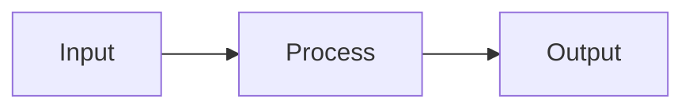
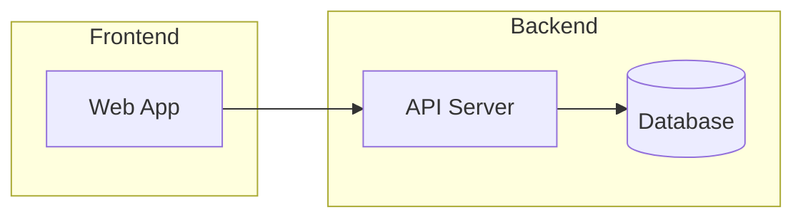

# Syntax basics

## Embedding in Markdown

Open a fenced code block with the `mermaid` language identifier:

````markdown

````

## Direction

Flowcharts and block diagrams accept a direction keyword after the diagram type:

| Direction | Meaning |
| --- | --- |
| `TD` or `TB` | Top to bottom |
| `LR` | Left to right |
| `BT` | Bottom to top |
| `RL` | Right to left |

Prefer `LR` for pipelines and data flows. Use `TD` for hierarchies and trees.

## Node Shapes

```text
A[Rectangle]     A(Rounded)       A([Stadium])
A[[Subroutine]]  A[(Cylinder)]    A((Circle))
A{Diamond}       A{{Hexagon}}     A[/Parallelogram/]
A[\Parallelogram\]  A[/Trapezoid\]  A[\Trapezoid/]
```

## Edge Syntax

```text
A --> B          Solid arrow
A --- B          Solid line (no arrow)
A -.-> B         Dotted arrow
A -.- B          Dotted line
A ==> B          Thick arrow
A == text ==> B  Thick arrow with label
A -- text --> B  Solid arrow with label
```

Place each edge on its own line for readability and reliable parsing.

## Subgraphs



Rules:

- `subgraph Name` and `end` must each be on their own line.
- To use spaces in a display name: `subgraph build_pipeline [Build Pipeline]`.
- Keep nesting shallow (max 2 levels) for reliable GitHub rendering.
